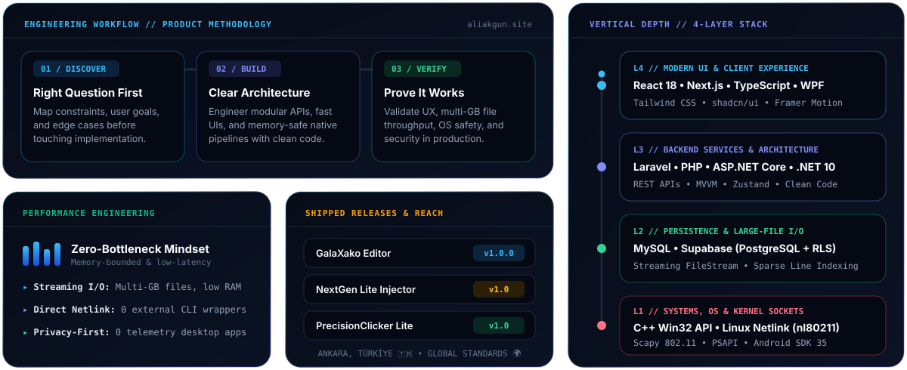

<!-- CINEMATIC COMMAND DECK HERO -->

  

<!-- ACTION DOCK -->

  
  
  
  

<!-- APPLE / LINEAR STYLE BENTO ARCHITECTURE GRID -->

  

## 🚀 Featured Engineering Builds

  
  

  
  

  
  

  
  &nbsp;
  
  &nbsp;
  

 

  
<b>📱 Explore Additional Mobile &amp; Android Repositories</b>

   

  * **[Mobile-Web-Viewer](https://github.com/AliAkgun0/Mobile-Web-Viewer)** (`Java • Android SDK 35 • AndroidX • SwipeRefreshLayout`) — Domain-locked native Android WebView application with pull-to-refresh, connectivity monitoring, and splash flow.
  * **[Calculator](https://github.com/AliAkgun0/calculator)** (`Java • Android XML • Material Light/Dark`) — Native Android calculator supporting automatic light and dark system themes with prebuilt APK.

## 🛠️ Technology Arsenal

<b>LANGUAGES</b>  
<picture>
  <source media="(prefers-color-scheme: dark)" srcset="https://skillicons.dev/icons?i=php,ts,js,cs,py,cpp,java,html,css&theme=dark" />
  <source media="(prefers-color-scheme: light)" srcset="https://skillicons.dev/icons?i=php,ts,js,cs,py,cpp,java,html,css&theme=light" />
  
</picture>

  
<b>FRAMEWORKS, DESKTOP &amp; MOBILE</b>  
<picture>
  <source media="(prefers-color-scheme: dark)" srcset="https://skillicons.dev/icons?i=laravel,dotnet,react,nextjs,nodejs,tailwind,bootstrap,vite,androidstudio&theme=dark" />
  <source media="(prefers-color-scheme: light)" srcset="https://skillicons.dev/icons?i=laravel,dotnet,react,nextjs,nodejs,tailwind,bootstrap,vite,androidstudio&theme=light" />
  
</picture>

  
<b>DATA, CLOUD, KERNEL &amp; DEVOPS</b>  
<picture>
  <source media="(prefers-color-scheme: dark)" srcset="https://skillicons.dev/icons?i=mysql,supabase,linux,cloudflare,git,github,vscode,visualstudio&theme=dark" />
  <source media="(prefers-color-scheme: light)" srcset="https://skillicons.dev/icons?i=mysql,supabase,linux,cloudflare,git,github,vscode,visualstudio&theme=light" />
  
</picture>

  <picture>
    <source media="(prefers-color-scheme: dark)" srcset="https://raw.githubusercontent.com/AliAkgun0/AliAkgun0/output/github-snake-dark.svg" />
    <source media="(prefers-color-scheme: light)" srcset="https://raw.githubusercontent.com/AliAkgun0/AliAkgun0/output/github-snake.svg" />
    
  </picture>

  

