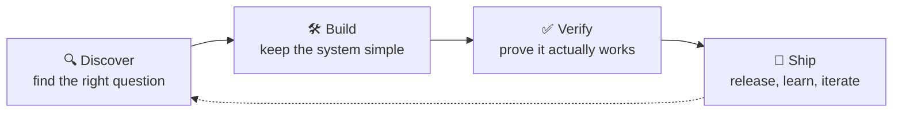

<!-- ═══════════════════════════════════════════════════════════════════
     Muhammed Ali Akgün · GitHub Profile README
     Palette: #0D1117 (bg) · #58A6FF (blue) · #A371F7 (purple) · #C9D1D9 (text)
     ═══════════════════════════════════════════════════════════════════ -->

<div align="center">


<a href="https://aliakgun.site">
  
</a>

<br/>

<a href="https://aliakgun.site"></a>
<a href="https://aliakgun.site/contact"></a>


<a href="https://github.com/AliAkgun0"></a>
<a href="https://github.com/AliAkgun0?tab=followers"></a>
<a href="https://github.com/AliAkgun0?tab=repositories"></a>

<br/>

**[About](#-about-me)** &nbsp;·&nbsp; **[Stack](#-tech-stack)** &nbsp;·&nbsp; **[Projects](#-featured-projects)** &nbsp;·&nbsp; **[How I Work](#-how-i-work)** &nbsp;·&nbsp; **[Stats](#-github-analytics)** &nbsp;·&nbsp; **[Contact](#-lets-connect)**

</div>

<br/>

## 👨‍💻 About Me

<table>
<tr>
<td width="55%" valign="top">

```ts
const ali = {
  name:      "Muhammed Ali Akgün",
  location:  "Ankara, Türkiye 🇹🇷",
  role:      "Software Development Student",
  title:     "Full-Stack Developer in Progress",
  speaks:    ["Türkçe", "English"],

  stack: {
    web:     ["PHP", "Laravel", "React", "Next.js", "TypeScript"],
    desktop: ["C#", ".NET", "WPF", "C++", "Win32"],
    mobile:  ["Java", "Android"],
    systems: ["Python", "Linux", "Scapy", "Netlink"],
  },

  building:  "GalaXako Editor — big files, clean lists",
  motto:     "Design ◆ Develop ◆ Secure ◆ Ship",
};
```

</td>
<td width="45%" valign="top">

I'm a software development student from **Türkiye** who likes turning ideas into **real, usable products** — not tech demos.

I work across the whole stack: **web platforms**, **Windows desktop apps**, **Android apps** and **Linux tooling**.

- 🚀 Building web apps with **PHP & Laravel**
- ⚛️ Crafting interfaces with **React & Next.js**
- 🖥️ Shipping desktop tools with **C# / .NET / WPF**
- 🐍 Writing **Python** for automation & networking
- 🔐 Treating **design, performance & security** as one decision
- 🌐 More at **[aliakgun.site](https://aliakgun.site)**

</td>
</tr>
</table>

<br/>

## 🧰 Tech Stack

<div align="center">

<table>
<tr>
<td align="center" width="25%"><b>💬 Languages</b></td>
<td align="center" width="75%"></td>
</tr>
<tr>
<td align="center"><b>🧱 Frameworks</b></td>
<td align="center"></td>
</tr>
<tr>
<td align="center"><b>🗄️ Data</b></td>
<td align="center"></td>
</tr>
<tr>
<td align="center"><b>🛠️ Tools</b></td>
<td align="center"></td>
</tr>
<tr>
<td align="center"><b>💻 Platforms</b></td>
<td align="center"></td>
</tr>
</table>

</div>

```text
Frontend   ▸ React · Next.js · TypeScript · Tailwind CSS · Zustand · shadcn/ui · Framer Motion
Backend    ▸ PHP · Laravel · ASP.NET Core · REST APIs · Supabase
Desktop    ▸ C# · .NET 10 · WPF · MVVM · AvalonEdit · C++ · Win32 API · PyQt5
Mobile     ▸ Java · Android SDK · WebView
Systems    ▸ Python · Scapy · pyroute2 / nl80211 · Linux networking
```

<br/>

## 🌟 Featured Projects

<table>
<tr>
<td width="50%" valign="top">

<h3>📝 GalaXako Editor</h3>

<a href="https://github.com/AliAkgun0/gxeditor"></a>


**Big files. Clean lists. Fast processing.**
A high-performance Windows editor for huge **TXT · LOG · CSV · TSV · JSONL** files — without loading them into RAM.

- ⚡ Streaming I/O, sparse line index & external sort
- 🧹 Filter, dedupe, extract (URL, e-mail, IP, hashes)
- 🔗 Chain operations into reusable **pipelines**
- 🔒 100% local — no telemetry, no uploads

<a href="https://github.com/AliAkgun0/gxeditor"></a>

</td>
<td width="50%" valign="top">

<h3>🛡️ Wi-Fi Security Framework</h3>

<a href="https://github.com/AliAkgun0/wifi-security-framework"></a>


**Wireless security assessment, straight from the kernel.**
A modular Python framework for authorized Wi-Fi security testing with zero shell dependencies.

- 🧠 Direct kernel control via **pyroute2 / Netlink**
- 📡 Real-time 802.11 parsing with **Scapy AsyncSniffer**
- 🩺 Kernel watchdog with autonomous driver recovery
- 🧵 Thread-safe, crash-resilient 4-phase pipeline

<a href="https://github.com/AliAkgun0/wifi-security-framework"></a>

</td>
</tr>
<tr>
<td width="50%" valign="top">

<h3>🔖 Bookmark Hub</h3>

<a href="https://github.com/AliAkgun0/Bookmark-Hub"></a>


**Modern, lightweight & persistent bookmark manager.**
Organize links into categories with a polished, animated UI — no backend needed.

- 🗂️ Custom categories with safe-delete migration
- 🌐 Automatic favicon fetching & one-click copy
- 🎞️ Micro-interactions with **Framer Motion**
- 🌗 Dark / light mode & LocalStorage persistence

<a href="https://github.com/AliAkgun0/Bookmark-Hub"></a>

</td>
<td width="50%" valign="top">

<h3>⏱️ FocusTime — Pomodoro</h3>

<a href="https://github.com/AliAkgun0/React-Pomodoro-Web"></a>


**Master your productivity.**
A beautiful Pomodoro web app with cloud-synced focus statistics.

- 🔁 Focus → short break → long break cycles
- 📊 Daily & total focus-time statistics
- 🔔 Browser notifications on session end
- ☁️ Supabase sync secured with Row Level Security

<a href="https://github.com/AliAkgun0/React-Pomodoro-Web"></a>

</td>
</tr>
</table>

<details>
<summary><b>🧪 More projects — desktop, mobile & experiments</b></summary>

<br/>

| Project | What it is | Tech |
| :--- | :--- | :--- |
| ⚙️ **[NextGen Lite](https://github.com/AliAkgun0/nextgen-lite-dll-injector)** | Native Windows process tool with a custom Win32 UI, process icons, filtering & system-process protection | `C++` `Win32 API` `GDI+` |
| 🖱️ **[PrecisionClicker Lite](https://github.com/AliAkgun0/PrecisionClicker-Lite)** | Lightweight auto-clicker with a dark UI, custom intervals & F6 hotkey | `Python` `PyQt5` |
| 📱 **[Mobile Web Viewer](https://github.com/AliAkgun0/Mobile-Web-Viewer)** | Locked-down Android WebView app with pull-to-refresh & connectivity checks (Android 8.1 → 15) | `Java` `Android SDK` |
| 🧮 **[Calculator](https://github.com/AliAkgun0/calculator)** | Clean Android calculator that adapts to light & dark system themes | `Java` `XML` |

</details>

<br/>

## 🧭 How I Work



> Not a technology showcase — products that are **clear, fast and actually used**.
> Design, performance and security are parts of the **same product decision**.

<br/>

## 📊 GitHub Analytics

<div align="center">


<picture>
  <source media="(prefers-color-scheme: dark)" srcset="https://raw.githubusercontent.com/AliAkgun0/AliAkgun0/output/github-snake-dark.svg" />
  <source media="(prefers-color-scheme: light)" srcset="https://raw.githubusercontent.com/AliAkgun0/AliAkgun0/output/github-snake.svg" />
  
</picture>

</div>

<br/>

## 🌱 Right Now

<table>
<tr>
<td width="33%" valign="top">

**🔭 Building**

- GalaXako Editor v1
- Laravel web platforms
- Full-stack side projects

</td>
<td width="33%" valign="top">

**📚 Learning**

- Full-stack architecture
- REST API design
- Clean code & software architecture

</td>
<td width="33%" valign="top">

**🎯 Goals**

- Ship a stable GalaXako release
- Contribute to open source
- Collaborate with teams in 🇹🇷 & 🌍

</td>
</tr>
</table>

<br/>

## 🤝 Let's Connect

<div align="center">

**Have an idea? Let's build something useful together.**

<a href="https://aliakgun.site"></a>
<a href="https://aliakgun.site/contact"></a>
<a href="https://github.com/AliAkgun0?tab=repositories"></a>

<br/><br/>

<sub>⭐ If you find something useful here, a star means a lot!</sub>


</div>
